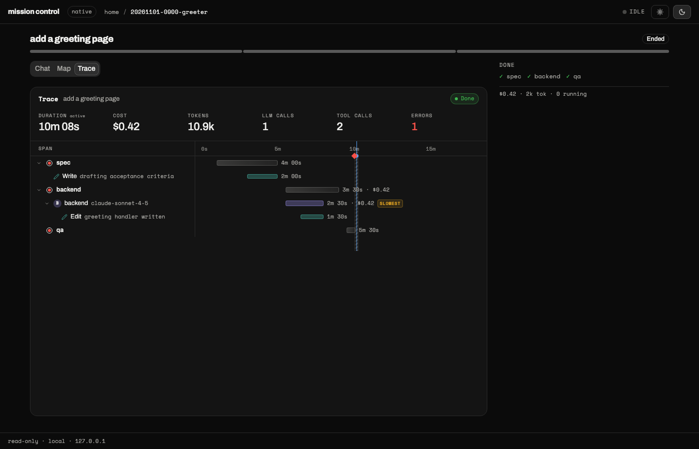

# mission-control

A local dashboard for agent harness runs: a run list, a per-run Trace waterfall (stages, LLM calls, tool calls, cost, tokens), a crew map, transcripts, and a "waiting on you" view. It reads a directory of runs in a small [documented format](FORMAT.md), so any harness (such as Ronin) can show up in it by writing two files per run. It also reads spec-kit-compound repos directly.



Zero runtime dependencies. Node 20.19 or newer.

## Start

Native runs directory (the format in [FORMAT.md](FORMAT.md)):

```bash
npx mission-control path/to/runs
# try the example from a clone of this repo:
npx mission-control examples/runs
```

A spec-kit-compound repo (one run per feature, stages from the files that exist):

```bash
npx mission-control --speckit path/to/repo
```

A bare path containing `specs/` and `docs/intents/` is detected as spec-kit; any other bare path is a runs directory.

A custom adapter:

```bash
npx mission-control --adapter ./my-adapter.mjs --runs path/to/runs --adapter-opt key=value
```

Flags: `--port <n>` (default 4319), `--no-open` (do not open a browser). It prints `mission control on http://localhost:<port>`.

## Adapters

An adapter is a JS module whose default export is `create(options)`, returning:

```js
{
  name: "my-harness",
  describe?: ...,
  listRuns(): Promise<RunSummary[]>,           // newest first
  getRun(id): Promise<{ state, events, live } | null>,
  getSession(id, name): Promise<{ text, truncated? } | null>,
  extras?: { [key]: (id | null, query: URLSearchParams) => Promise<{ status?, type?, body }> },
  actions?: { [key]: (id, body) => Promise<object> },   // throw { status, message } to refuse
}
```

`RunSummary` is `{ id, idea, repo?, live, stages: { [stage]: { status, rounds? } }, harness? }`.

External adapters are called as `create({ ...opts, runsDir, createNative })`: `opts` are the `--adapter-opt k=v` pairs, `runsDir` is the resolved `--runs` directory, and `createNative` is the built-in runs-directory adapter factory, so you can wrap it and add to it without importing package paths.

`extras` feed optional tabs, served at `GET /api/x/<key>[/<id>]`. The page knows `tasks`, `qa`, `diff`, `artifacts`, `raw`, `brain`, `project`, `doc`, `drift`, `tokens`, and shows a tab only when the adapter lists it. `actions` (`sign`, `say`) are served at `POST /api/run/<id>/action/<name>`; the page shows the buttons only for actions the adapter declares. `GET /api/capabilities` lists what the current adapter provides.

## Security

Local only, no auth. The server binds `127.0.0.1` and `::1`, and anything on this machine can call the action routes an adapter declares. The built-in adapters declare none: they are read-only and never write to a runs directory or a repo. The page makes no network requests (fonts are bundled).

## Develop

```bash
npm ci
npm run build   # builds the React app into dist/
npm test
```

## License

MIT
