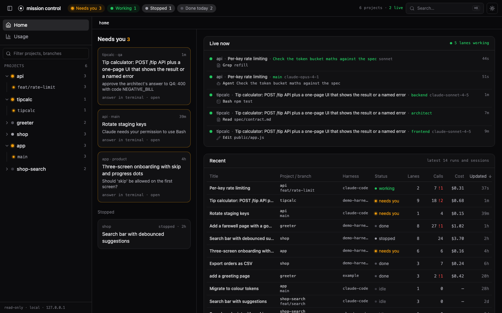
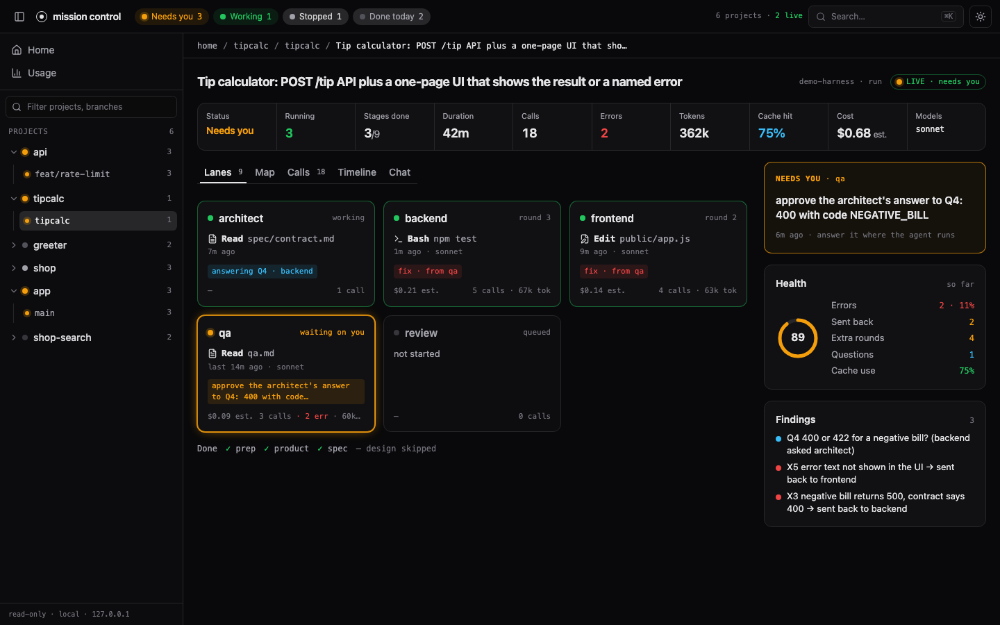
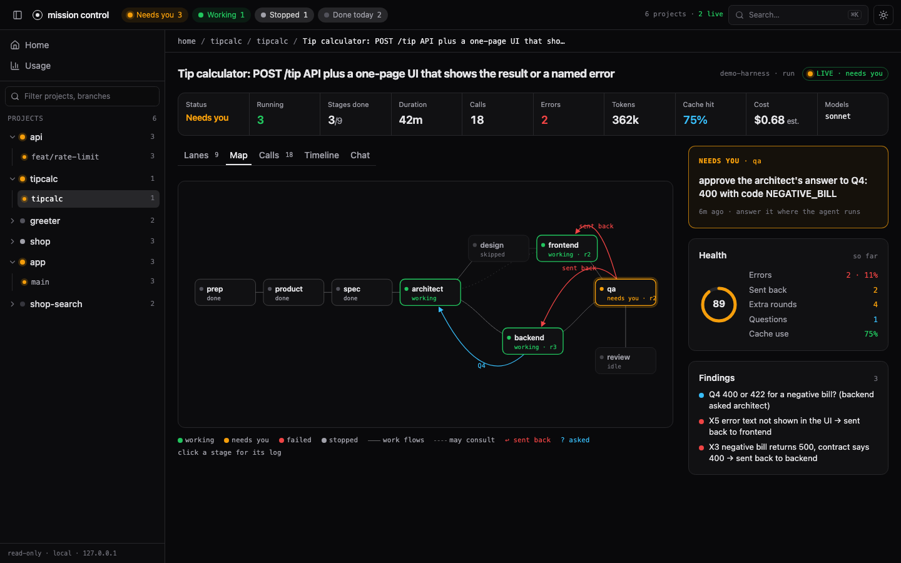
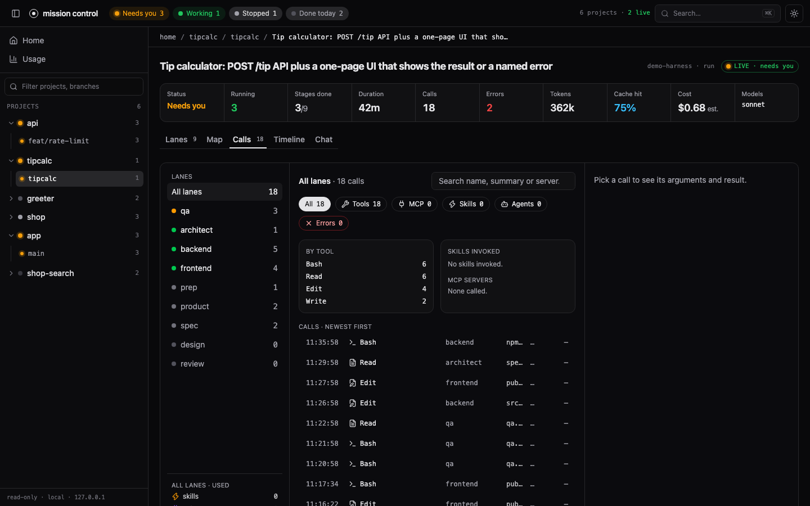
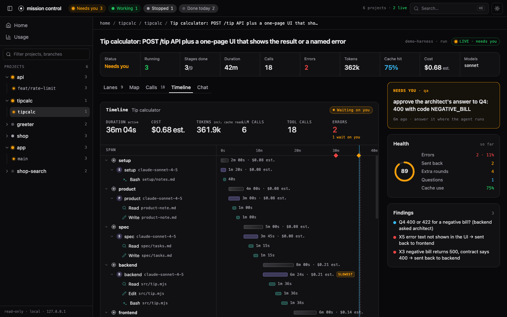
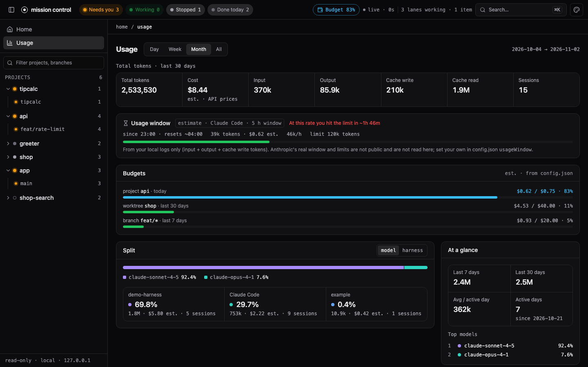
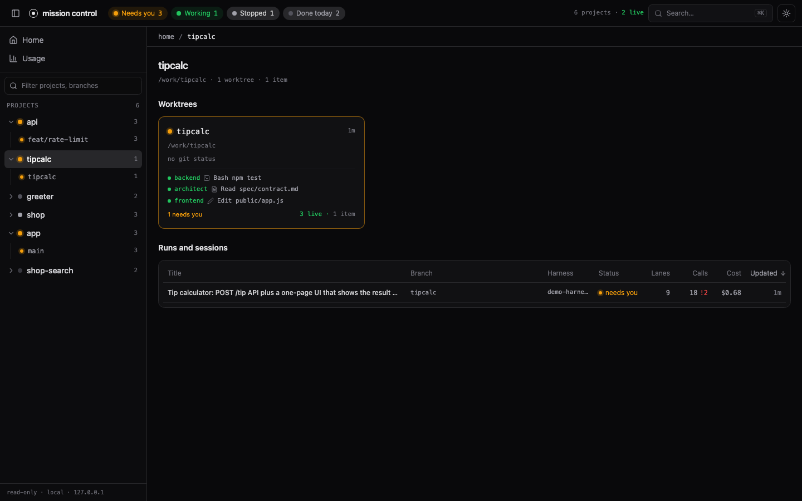

# mission-control

One local dashboard for all your AI coding work. It organises everything as **projects → worktrees → sessions and runs → lanes**: a project is a repository, a worktree is a checkout of it (a branch), a session or run is one piece of agent work, and a lane is one agent inside it (the main agent, a subagent, a harness stage, a crew member). A "Needs you" queue collects everything that is blocked on a human.

It reads Claude Code and Codex CLI sessions with no setup, and any other harness that writes a small run format or ships an adapter.

▶ [Watch the 60-second demo](https://ronincrew.dev/mission-control)



Zero runtime dependencies. Runtime: Node 20 or newer. Building the page and running the tests need Node 20.19 or newer. Strictly local and read-only.

## Quick start

You need `git` and Node 20.19 or newer (`node --version` prints it). The package is not on npm yet, so you run it from a clone.

### With Claude Code

1. Get the code and build the page:

   ```bash
   git clone https://github.com/aldefy/mission-control
   cd mission-control
   npm ci
   npm run build
   ```

2. Start it:

   ```bash
   node bin/mission-control.mjs
   ```

   It prints `mission control on http://localhost:4319` and, on macOS, opens that page. Elsewhere, open the URL yourself. Leave the command running; stop it with Ctrl-C.

3. Look at the home page. Every Claude Code session under `~/.claude/projects` is listed, grouped by project and worktree. Open one to see its lanes (the main agent and each subagent), calls, timeline, chat and usage.

4. Optional, for the **Needs you** queue: install the hooks.

   ```bash
   node bin/mission-control.mjs hooks install
   ```

   This prints a `hooks` block. Merge it into `~/.claude/settings.json` by hand (it changes nothing itself), then start a new Claude Code session. A session that asks for permission now shows up under Needs you. Full details, including the exact block, are in [docs/claude-code.md](docs/claude-code.md).

### With Codex CLI

1. Get the code and build the page (skip this if you did it above):

   ```bash
   git clone https://github.com/aldefy/mission-control
   cd mission-control
   npm ci
   npm run build
   ```

2. Start it:

   ```bash
   node bin/mission-control.mjs
   ```

   Codex sessions are read from `~/.codex/sessions` whenever that directory exists, next to any Claude Code sessions. If your Codex home is elsewhere, pass the sessions directory: `node bin/mission-control.mjs --codex-dir /work/codex-home/sessions`.

3. Open `http://localhost:4319`. Codex sessions show with the harness `codex`: project, branch, title, calls (shell commands, patches, MCP tools, spawned agents), tokens and estimated cost. Subagents Codex spawned are lanes of the session that spawned them.

4. Optional, for the **Needs you** queue: install the Codex hooks.

   ```bash
   node bin/mission-control.mjs hooks install codex
   ```

   This prints a `hooks` block for `~/.codex/hooks.json`. Merge it in by hand, then run `/hooks` inside Codex to review and trust the new hooks (Codex does not run untrusted hooks). A session waiting for your approval now shows up under Needs you. Full details are in [docs/codex.md](docs/codex.md).

### Check that it works

```bash
curl -s http://localhost:4319/api/sources
```

lists every source that is on (`claude-code`, `codex`, and any runs or adapters you passed), with the directory each one reads. `curl -s http://localhost:4319/api/items` lists what the home page shows. An empty list with the source present means the directory has no sessions yet: run one Claude Code or Codex session and reload.

### Common problems

| what you see | what to do |
|---|---|
| `npm ci` or `npm run build` fails on syntax or engine errors | Node is too old. Install Node 20.19 or newer and run both again. |
| The browser shows a 404 and the terminal says `no built page ... run npm run build` | The page was not built in this checkout. Run `npm run build`, then restart. The API works without it. |
| `EADDRINUSE` or "port in use" | Something already listens on 4319 (maybe another copy). Use `--port 4400`, or set `MISSION_CONTROL_PORT`. |
| No Claude Code sessions | Sessions live in `~/.claude/projects`. If yours are elsewhere, pass `--claude-dir <dir>`. |
| No Codex sessions | Codex turns on only when `~/.codex/sessions` exists. Pass `--codex-dir <dir>` if `CODEX_HOME` points somewhere else. |
| Needs you stays empty | Hooks are optional and off until you merge the printed block. After moving the checkout or upgrading Node, run `hooks install` again and merge again: the block holds absolute paths. |
| Costs look wrong | They are API list-price estimates, not your bill. See [Costs are estimates](#costs-are-estimates). |

## Try it with demo data

```bash
npm run demo                      # synthetic projects, sessions and runs on http://localhost:4320
npm run demo -- --port 4400       # another port
npm run demo -- --live            # keep appending to the live session and the busy run
```

The demo generates invented data into `examples/claude`, `examples/hooks` and `examples/runs` and serves it; the generated files are git-ignored (one sample run, `examples/runs/20261101-0900-greeter`, is tracked). It defaults to port 4320 so it never clashes with a real dashboard on 4319. It never reads your own `~/.claude` or `~/.codex`.

## Flags

| flag | meaning |
|---|---|
| `--port <n>` | port to listen on (default 4319; or set `MISSION_CONTROL_PORT`) |
| `--no-open` | do not open a browser |
| `--claude-dir <dir>` | a Claude Code projects directory instead of `~/.claude/projects` |
| `--no-claude` | skip Claude Code |
| `--codex-dir <dir>` | a Codex sessions directory instead of `~/.codex/sessions` (turns Codex on) |
| `--no-codex` | skip Codex |
| `--runs <dir>` | a directory of runs in the [run format](FORMAT.md) |
| `--speckit <repo>` | a spec-kit-compound repository |
| `--adapter <file>` | your own adapter module; `--adapter-opt k=v` passes options to it (repeatable) |

Other commands: `hooks install` prints the Claude Code hooks block, `hooks install codex` the Codex one; `hook <Event>` and `hook codex` are what those hooks run.

## Levels: how much you set up

| level | what you do | what you get |
|---|---|---|
| 0 | nothing | Claude Code sessions under `~/.claude/projects` and Codex CLI sessions under `~/.codex/sessions` appear on their own: projects, worktrees, subagent lanes, calls, tokens, estimated cost, usage history |
| 1 | install the hooks | the **Needs you** queue and live status: a session that is asking for permission or approval shows up as waiting |
| 2 | write runs in the [run format](FORMAT.md) | any harness shows up as a run with stages as lanes, a timeline and a crew map |
| 3 | write an adapter | your own source: extra tabs, action buttons, anything the run format cannot say |

## Use with your own harness

If your agents are not Claude Code or Codex, you have two ways in, both covered step by step in [docs/own-harness.md](docs/own-harness.md):

- **Level 2, the run format.** Your harness writes two files per run, `state.json` (title and stages) and `runs.jsonl` (one event per line: stage start and end, LLM sessions with tokens, tool progress, issues, stops that wait on a human). Point the dashboard at the directory with `--runs /work/runs`. No code runs inside the dashboard. The full reference is [FORMAT.md](FORMAT.md).
- **Level 3, an adapter.** A JS module whose default export is `create(options)`, loaded with `--adapter /work/my-adapter.mjs`. It can return runs (a v1 adapter, wrapped for you) or items with lanes and calls (a v2 source), and it can add tabs and action buttons such as Sign and Answer.

The guide has a complete worked run, writer snippets in Node, Python and Bash, a minimal adapter file, and a checklist.

## The pages

**Home** lists what needs you, what is live, and the latest work across every project.

**Run / session page** has tabs. Lanes shows one card per agent with what it is doing now. Map draws the crew and how work flowed between lanes.





**Calls** lists every tool, MCP, skill and subagent call, filterable by lane and kind and searchable, with arguments and results.



**Timeline** is a waterfall of lanes, LLM calls and tool calls over time, with the slowest span marked.



**Chat** shows a session's conversation one lane at a time, with tool calls as chips.

**Usage** shows tokens and estimated cost by day, week or month, split by model or harness, with an activity heatmap and breakdowns by project, worktree and branch.



**Project** shows a project's worktrees with live lanes and its runs and sessions.



All screenshots come from the synthetic demo data.

## Costs are estimates

Costs are API list-price estimates computed from token counts (input, output, cache write, cache read) and the model, and the page marks them "est.". For Claude models the price goes by family and version (for example Opus 4/4.1 at $15/$75 per million tokens, Opus 4.5 and later at $5/$25). For OpenAI models used by Codex only exact model ids in the table are priced (for example `gpt-5` at $1.25/$10 with cached input at $0.125); a model id the table does not list, including a newer version, costs nothing and shows as "–" (no price). They are not your bill: plans, subscriptions (a ChatGPT or Claude plan) and discounts differ, and list prices change. Both tables are dated and live in `src/sources/claude-code/prices.mjs`; edit them when they go stale.

## Hiding projects

Tool-internal projects (for example an observer's data directory) are hidden by default. To hide more, create `~/.mission-control/config.json`:

```json
{ "hide": ["/work/scratch", "project-name"] }
```

Each entry is a project path or name. The file is re-read when it changes. Hidden projects stay reachable from a filter toggle in the sidebar.

## Security

Local only, no auth. The server binds `127.0.0.1` and `::1` and:

- answers only requests whose `Host` is `localhost`, `127.0.0.1` or `[::1]` on its own port (anything else gets 403), so a web page cannot reach it through DNS rebinding;
- takes a POST only with `content-type: application/json` (else 415) and, when the browser sends an `Origin`, only from `http://localhost:<port>`, `http://127.0.0.1:<port>` or `http://[::1]:<port>` (else 403), so another site cannot submit to the action routes.

The built-in sources are read-only: they never write to a runs directory, a repo, `~/.claude` or `~/.codex`. The only things written are the hook logs under `~/.mission-control/hooks` and a usage cache under `~/.mission-control/cache`. Session names are confined to their root, so `..` and symlinks out of it are refused. The page makes no network requests: it uses system fonts and loads nothing from outside the server.

## Develop

```bash
npm ci
npm run build       # builds the React app into dist/
npm test            # node tests + vitest
npm run typecheck
npm run dev         # vite dev server for the page
```

## License

MIT
